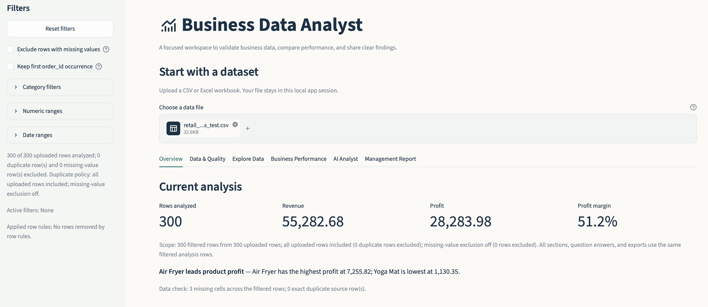
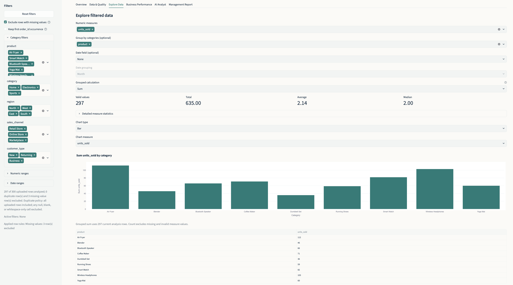
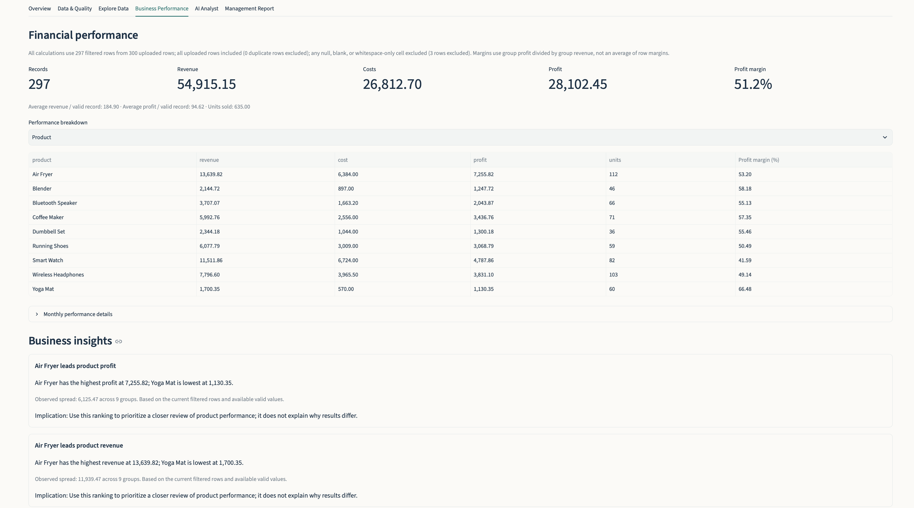
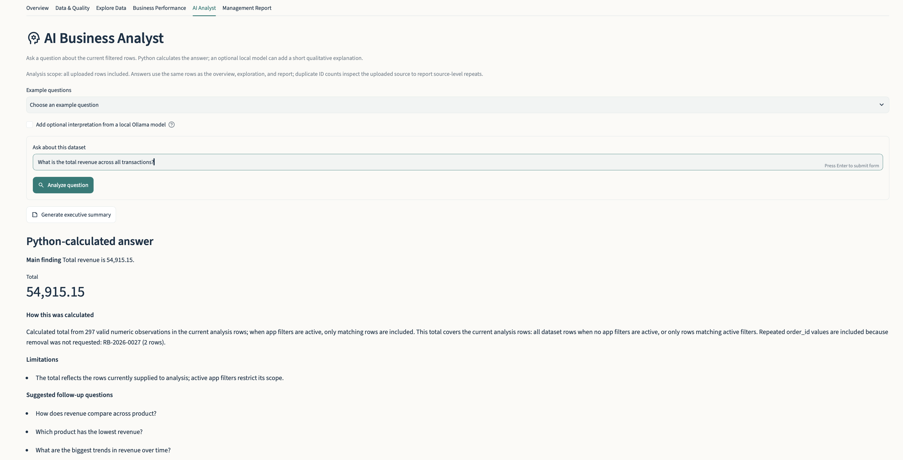
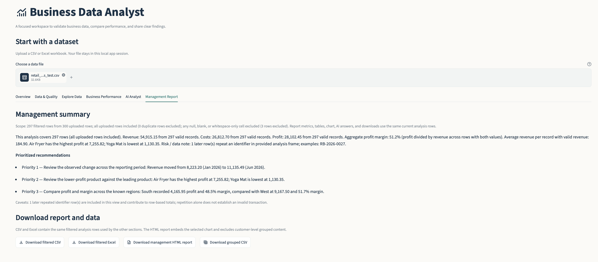

# AI Business Analyst

A local-first Streamlit portfolio project for exploring business data, checking data quality, comparing performance, and preparing a concise management report. It is intended for analysts, business teams, and managers who need to inspect a CSV or Excel file without building a custom dashboard first.

The application combines deterministic Python calculations with an optional local language model for qualitative wording. It is a working portfolio project, not a production or enterprise analytics platform.

## Key features

- Upload CSV, XLS, and XLSX files; choose a worksheet when a workbook has multiple sheets.
- Preview data and profile dataset dimensions, inferred types, missing values, nonnumeric values in numeric-looking columns, date parsing, and duplicates.
- Filter by category, numeric range, and date range. **Exclude rows with missing values** is off by default and excludes a row if any cell is null, blank, or whitespace-only. Numeric zero is retained.
- Optionally keep only the first occurrence of a detected identifier. By default, repeated IDs remain in the analysis. The source upload is never changed.
- Group numeric measures by one or more categories or dates and calculate count, sum, mean, median, minimum, maximum, and standard deviation.
- Explore data with Plotly bar, pie, histogram, line, box, and scatter charts when the selected columns support them.
- Calculate revenue, cost, profit, aggregate profit margin, record counts, averages, units, segment breakdowns, and monthly summaries when relevant fields exist. The app does not infer missing financial measures.
- Generate deterministic, evidence-based findings and management recommendations from Python-calculated results. Recommendations are limited to findings supported by the current data.
- Ask common natural-language business questions in the **AI Analyst** section. The local Python question engine calculates all figures and explains unsupported or insufficient questions.
- Optionally use an already installed local Ollama model to phrase a qualitative interpretation. This is separate from Python analysis: the model does not calculate or replace numeric answers, and the core app works without Ollama.
- Create a deterministic management summary and download filtered data as CSV or Excel, grouped data as CSV when available, and a standalone HTML management report with the selected chart.

## Technology stack

- Python 3.10 or newer
- Streamlit for the local web interface
- pandas for loading, profiling, filtering, and analysis
- Plotly for interactive charts
- openpyxl for XLSX reading and Excel exports
- xlrd for legacy XLS reading
- Matplotlib for the original command-line example in `main.py`
- Ollama's local HTTP API is an optional integration; the adapter uses Python's standard library and adds no Ollama Python package

## Project structure

| Path | Purpose |
| --- | --- |
| `app.py` | Streamlit app, six sections, shared filters, charts, AI controls, and downloads |
| `analysis.py` | File loading, profiling, filtering, aggregation, business metrics, insights, and CSV/Excel/HTML report helpers |
| `business_analyst.py` | Deterministic question parsing, Python calculations, follow-up questions, and executive summaries |
| `charts.py` | Plotly chart builders and shared chart styling |
| `ollama_provider.py` | Optional loopback-only Ollama adapter and interpretation checks |
| `presentation.py` | Table presentation and column configuration |
| `main.py` | Separate original command-line sales example |
| `sales.csv`, `test.csv` | Small month-and-sales examples |
| `sales_chart.png` | Existing chart artifact for the command-line example |
| `retail_business_test.csv` | Synthetic 300-row retail test dataset; not real customer or company data |
| `tests/` | Unit tests, Streamlit AppTests, report/chart tests, provider tests, and command-line edge-case tests |
| `.streamlit/config.toml` | Streamlit light theme and chart palette |
| `requirements.txt` | Runtime dependencies |

The Streamlit app stores the parsed upload in the current Streamlit session and does not use a global shared dataframe cache. The original command-line program is separate from `app.py`. It prompts for a CSV with `month` and `sales` columns and saves `sales_chart.png` in its current working directory; run it from a disposable directory if you do not want to replace the included chart artifact.

## Installation and local setup

These commands are for macOS with Python 3.10 or newer installed. Open Terminal and change to the project directory (replace the path with your local checkout location):

```bash
cd /path/to/ai-business-analyst
python3 --version
python3 -m venv .venv
source .venv/bin/activate
python -m pip install --upgrade pip
python -m pip install -r requirements.txt
```

Start the Streamlit app:

```bash
streamlit run app.py
```

Streamlit prints a local URL in the terminal and normally opens it in your browser. Stop the server with **Ctrl+C** in that terminal. To run the tests, use the project environment:

```bash
./.venv/bin/python -m unittest discover -s tests -v
```

The application works without Ollama and without internet access after the Python dependencies are installed. Ollama is optional: install and run it separately, and download a local model yourself if you want qualitative wording. The app only offers models available from the local Ollama service at `127.0.0.1:11434`; it does not install Ollama or download models.

## How to use the application

Upload a CSV or Excel workbook at the top of the app. For a workbook with multiple sheets, choose the worksheet to analyze. The sidebar contains shared row rules and category, numeric, and date filters. **Reset filters** clears those filters and restores their default state.

The six sections serve different needs:

1. **Overview** — current row count, available headline metrics, scope, and a concise finding.
2. **Data & Quality** — uploaded-data preview and full-file quality profile, alongside a profile of the filtered analysis rows. This section retains the original upload even when analysis row rules are enabled.
3. **Explore Data** — choose numeric measures, category dimensions, date grouping, aggregation, and a supported chart. Chart and measure controls are separate from the shared filter state.
4. **Business Performance** — available financial metrics and segment breakdowns, time summaries, and calculated business insights.
5. **AI Analyst** — ask supported natural-language questions, review Python-calculated evidence, and optionally request qualitative wording from local Ollama.
6. **Management Report** — executive summary, evidence-backed recommendations and caveats, plus download controls.

Analysis scope is applied in this order: optional keep-first identifier handling, optional missing-row exclusion, then category, numeric, and date filters. The sidebar reports the row count and exclusions. The analysis, supported questions, insights, recommendations, and report use the resulting filtered data. CSV and Excel downloads contain the current filtered analysis rows; the HTML report uses the same current scope. The Data & Quality full-file profile always describes the original upload.

Repeated identifiers are included by default. If an identifier is detected, the **Keep first … occurrence** option can explicitly exclude later rows with that ID. This option does not alter the uploaded data. When enabled, reports and scope labels disclose the first-occurrence policy and number of excluded rows. Missing-value exclusion is also optional and unchecked by default. Zero is a valid value, not a missing value.

The deterministic question engine supports common questions about totals, averages, rankings, category breakdowns, comparisons, changes over time, correlation, duplicate IDs, and data quality. It is not a general-purpose language model; unsupported wording is identified rather than answered with guessed figures. Python remains the source of truth for all numbers. Optional Ollama receives only the question and compact calculated evidence for qualitative interpretation, not the uploaded rows. Its generated wording is checked for added numeric and causal claims.

## Example dataset and validation

`retail_business_test.csv` is synthetic test data. It represents 300 retail transactions from January through June 2026 and contains no real customer or company records. Its intentional data-quality issues are:

- Missing `customer_type` at CSV row 19 (`RB-2026-0018`).
- Missing `sales_channel` at CSV row 80 (`RB-2026-0079`).
- Missing `region` at CSV row 157 (`RB-2026-0156`).
- Duplicate `order_id` `RB-2026-0027` at CSV rows 28 and 202. With the default policy, both rows are included; with keep-first enabled, row 202 is excluded.

The verified tests establish these benchmark results:

| Scope | Result |
| --- | ---: |
| All 300 uploaded rows, duplicate included | Revenue 55,282.68 |
| Keep the first occurrence of each order ID | 299 rows; revenue 54,992.40; cost 26,834.70; profit 28,157.70; aggregate profit margin 51.20% |
| Highest-revenue month after keep-first | June 2026 — 11,135.49 |
| Highest-profit product after keep-first | Air Fryer — 7,255.82 |
| Highest-profit known region after keep-first | West — 9,167.50 |

Revenue, cost, and profit totals use finite numeric values in their respective columns. Aggregate margin is total profit divided by total revenue for rows with both values; it is not the mean of row-level margins. Missing-value exclusion removes any row with at least one null, blank, or whitespace-only cell. These benchmark values use the explicitly stated duplicate scope and do not imply that duplicate IDs are necessarily erroneous transactions.

## Testing

Run the complete test suite with:

```bash
./.venv/bin/python -m unittest discover -s tests -v
```

The latest recorded suite run passed **91 tests**. Coverage includes calculations and edge cases, retail benchmarks, duplicate and missing-value policies, filters and reset interactions, charts, AI question routing, report consistency and escaping, optional Ollama safety/fallback behavior, and the legacy CLI. Streamlit AppTests exercise the app's widgets and state; they are not browser automation and do not replace a manual visual check in a real browser.

To compile the main application and test modules:

```bash
./.venv/bin/python -m compileall -q app.py analysis.py charts.py business_analyst.py presentation.py ollama_provider.py tests
```

## Limitations and future improvements

- This is a local portfolio project. Authentication, multi-user hosting, persistent storage, deployment, and operational monitoring are not implemented.
- The question engine recognizes common analytical patterns, not arbitrary natural language. It does not forecast or add external business context.
- Optional Ollama requires a separately installed local service and a model downloaded by the user. It is not needed for analysis and no hosted model provider is configured.
- PDF export is not included. The app provides a standalone HTML report instead.
- Automatic date and business-column detection uses heuristics and common names. Ambiguous dates or unusual column names may need to be standardized or selected manually.
- Category filters are limited to columns with at most 80 distinct nonmissing values. High-cardinality columns can still be used as dimensions where supported.
- Outlier and large-change flags are screening signals, not proof of an error, cause, or forecast.
- HTML reports omit customer- or person-level grouped content when the selected dimension appears sensitive. The report is intended for sharing but does not replace a privacy review of the source data.

Possible next steps include testing with additional business datasets and adding browser-level interaction checks. These are not represented as completed features.

## Screenshots

The screenshots below are stored in `screenshots/` at the project root and are embedded using repository-relative paths so they display when this README is viewed on GitHub.

### Overview



*Overview — dataset scope, current metrics, and an at-a-glance finding.*

### Explore Data



*Explore Data — select measures, dimensions, aggregations, and chart types.*

### Business Performance



*Business Performance — financial metrics, segment comparisons, and evidence-backed findings.*

### AI Analyst



*AI Analyst — ask dataset-grounded questions and review Python-calculated evidence.*

### Management Report



*Management Report — executive summary, supported recommendations, and report downloads.*

## Portfolio summary

**AI Business Analyst** is a local-first Python and Streamlit portfolio application that helps users validate CSV and Excel data, explore business performance, ask dataset-grounded questions, and prepare management reports. It demonstrates Python and pandas analysis, data-quality handling, filter and aggregation design, interactive Plotly visualization, deterministic natural-language question routing, optional local-model integration, report generation, and automated testing. All numerical results are calculated in Python, with findings and recommendations tied to observed evidence.

Skills demonstrated:

- Python application development and modular code organization
- pandas data loading, profiling, cleaning rules, aggregation, and validation
- Business KPI and profitability analysis, including aggregate margin calculations
- Streamlit interfaces, session state, filters, and interaction testing
- Plotly visualization and chart suitability decisions
- Deterministic natural-language intent routing and evidence-grounded answers
- Optional local AI integration with constrained context and fallback behavior
- HTML/Excel/CSV reporting and output escaping
- Unit testing, regression testing, and edge-case handling
